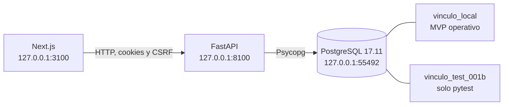

# VINC-001B: laboratorio local de Windows

Estado comprobado el 28 de noviembre de 2026. Esta guía describe el laboratorio
existente de Vínculo; los nombres conservan la referencia `136824a` aunque la
corrección CORS se desarrolle en otra rama. El flujo de fidelización es ficticio:
no procesa pagos, inventario ni ventas reales.

## Arquitectura y versiones verificadas



| Herramienta | Versión observada |
|---|---|
| Windows PowerShell | 5.1.26100.10068 |
| Git | 2.55.0.windows.4 |
| Python | 3.12.10 |
| uv | 0.12.5 |
| Node.js | 22.23.2 |
| npm | 12.0.2 |
| Docker | 29.7.2 |
| Docker Compose | 5.5.0 |
| PostgreSQL | 17.11 |

`apps/api` contiene FastAPI, modelos SQLAlchemy, Alembic y pytest. `apps/web`
contiene Next.js. El navegador usa `NEXT_PUBLIC_API_URL` y envía cookies de
sesión y cabecera CSRF; la API aplica permisos por rol. El middleware demo
restringe rutas y métodos antes de CORS, excepto preflights cuya ruta y método
solicitado pertenecen a la lista demo. CORS decide sobre origen y cabeceras.

## Recursos exclusivos

| Recurso | Identificador |
|---|---|
| Proyecto Compose | `vinculo001b_136824a` |
| Contenedor | `vinculo001b_136824a_pg17` |
| Red bridge, `internal: false` | `vinculo001b_136824a_net` |
| Volumen persistente | `vinculo001b_136824a_pgdata` |
| Imagen fijada | `postgres@sha256:ff87138949ad9a46f32ff23bd6852b52ce024a13dffe9b4087be98292cdd3b4f` |
| Usuario y base operativa | `vinculo_local` |
| Base de pruebas | `vinculo_test_001b` |

PostgreSQL publica `127.0.0.1:55492:5432`; la red dedicada usa bridge normal.
`internal: true` dejó el binding solicitado sin conectividad efectiva desde
Windows y se corrigió conservando el volumen. No hay un archivo Compose
persistido en el repositorio para este laboratorio: compruebe las etiquetas del
proyecto y los nombres anteriores antes de actuar sobre recursos existentes.
Nunca use `docker compose down -v` ni una limpieza general para pararlo.

Configuración equivalente para **reconstrucción autorizada de un laboratorio
nuevo**, no para ejecutar sobre el volumen actual. `VINCULO_LOCAL_DB_PASSWORD`
debe existir solo en el entorno temporal de esa sesión y provenir de DPAPI;
no escriba la contraseña en YAML ni en `.env`:

```yaml
services:
  db:
    image: postgres@sha256:ff87138949ad9a46f32ff23bd6852b52ce024a13dffe9b4087be98292cdd3b4f
    container_name: vinculo001b_136824a_pg17
    environment:
      POSTGRES_USER: vinculo_local
      POSTGRES_PASSWORD: ${VINCULO_LOCAL_DB_PASSWORD:?}
      POSTGRES_DB: vinculo_local
    ports:
      - "127.0.0.1:55492:5432"
    volumes:
      - pgdata:/var/lib/postgresql/data
    networks:
      - net
    healthcheck:
      test: ["CMD-SHELL", "pg_isready -U vinculo_local -d vinculo_local"]
      interval: 5s
      timeout: 3s
      retries: 20
networks:
  net:
    name: vinculo001b_136824a_net
    driver: bridge
    internal: false
volumes:
  pgdata:
    name: vinculo001b_136824a_pgdata
```

Para una reconstrucción aprobada, pase ese YAML por entrada estándar a
`docker compose -p vinculo001b_136824a -f - config --quiet` y, solo si valida
con código de salida cero, a `docker compose -p vinculo001b_136824a -f - up -d db`.
Use el proyecto explícito en ambos comandos. Si los recursos ya existen, use
el procedimiento de arranque de abajo sin recrearlos.

## Identidad local y DPAPI

Los archivos ignorados por Git en la raíz son `.env.vinculo-pg.dpapi` y
`.env.vinculo-demo.dpapi`. Son blobs binarios creados con
`ProtectedData.Protect(..., DataProtectionScope.CurrentUser)` bajo el usuario
Windows `juanfe`, con **dos entropías adicionales distintas codificadas en
UTF-8**. No son texto Base64 ni `SecureString`. El primero contiene 32 bytes
aleatorios; la contraseña PostgreSQL se obtiene como hexadecimal minúsculo de
esos bytes. El segundo contiene JSON UTF-8 con `owner`, `cashier` y `customer`,
cada uno con `username` y `password` ficticios.

Huellas de los archivos cifrados, útiles para detectar sustituciones:

| Archivo | SHA-256 |
|---|---|
| `.env.vinculo-pg.dpapi` | `7B7C0082D9097A0F75DA2ADDDAD2E45F61979B402C4B52FA706E9FCAE8B39E98` |
| `.env.vinculo-demo.dpapi` | `3FAECCC2CC48535065BFFA278E52E8E8D702A491068B8DC72E84CF47D5F94EC8` |

Recupere las entropías originales del registro local seguro de la creación en
las fases 2 y 3, o del registro privado del operador. **No las adivine ni las
publique.** Sin ambas entropías, copiar los blobs a otra sesión no basta para
descifrarlos. Esta plantilla solicita las entropías sin eco y valida la forma
de los resultados; se ejecuta en PowerShell 5.1 bajo `juanfe`, nunca bajo
`CodexSandboxOffline`:

```powershell
$ErrorActionPreference = 'Stop'
$repo = 'C:\Users\juanfe\Documents\vinculo'
Add-Type -AssemblyName System.Security
function Read-EntropyBytes([string] $prompt) {
    $secure = Read-Host -Prompt $prompt -AsSecureString
    $pointer = [Runtime.InteropServices.Marshal]::SecureStringToBSTR($secure)
    try {
        return ,([Text.Encoding]::UTF8.GetBytes(
            [Runtime.InteropServices.Marshal]::PtrToStringBSTR($pointer)))
    } finally {
        [Runtime.InteropServices.Marshal]::ZeroFreeBSTR($pointer)
        $secure.Dispose()
    }
}
$pgEntropy = Read-EntropyBytes 'Entropía original de PostgreSQL'
$demoEntropy = Read-EntropyBytes 'Entropía original de cuentas demo'
$pgRaw = $null; $demoRaw = $null
try {
    $pgPath = Join-Path $repo '.env.vinculo-pg.dpapi'
    $demoPath = Join-Path $repo '.env.vinculo-demo.dpapi'
    if ((Get-FileHash $pgPath -Algorithm SHA256).Hash -ne
        '7B7C0082D9097A0F75DA2ADDDAD2E45F61979B402C4B52FA706E9FCAE8B39E98') { throw 'PG blob changed' }
    if ((Get-FileHash $demoPath -Algorithm SHA256).Hash -ne
        '3FAECCC2CC48535065BFFA278E52E8E8D702A491068B8DC72E84CF47D5F94EC8') { throw 'Demo blob changed' }
    $scope = [Security.Cryptography.DataProtectionScope]::CurrentUser
    $pgRaw = [Security.Cryptography.ProtectedData]::Unprotect(
        [IO.File]::ReadAllBytes($pgPath), $pgEntropy, $scope)
    $demoRaw = [Security.Cryptography.ProtectedData]::Unprotect(
        [IO.File]::ReadAllBytes($demoPath), $demoEntropy, $scope)
    if ($pgRaw.Length -ne 32) { throw 'PG credential has unexpected format' }
    $accounts = [Text.Encoding]::UTF8.GetString($demoRaw) | ConvertFrom-Json
    foreach ($role in @('owner', 'cashier', 'customer')) {
        if (-not $accounts.$role.username -or $accounts.$role.password.Length -lt 24) {
            throw 'Demo credential has unexpected format'
        }
    }
    # Mantenga $accounts y el hexadecimal de $pgRaw solo en memoria. No los imprima.
    'DPAPI: ambos archivos recuperados y validados'
} finally {
    if ($pgRaw) { [Array]::Clear($pgRaw, 0, $pgRaw.Length) }
    if ($demoRaw) { [Array]::Clear($demoRaw, 0, $demoRaw.Length) }
    [Array]::Clear($pgEntropy, 0, $pgEntropy.Length)
    [Array]::Clear($demoEntropy, 0, $demoEntropy.Length)
    $accounts = $null
}
```

El bloque anterior **solo comprueba y limpia**. Para arrancar la API, repita
`Unprotect` en un nuevo bloque `try/finally` que incluya `Start-Process`; no
suponga que `$pgRaw` siga disponible después del bloque de comprobación.

Para acceso manual, use `owner`, `cashier` o `customer` y su contraseña **local**
recuperada bajo el usuario autorizado. Las contraseñas de Vercel son distintas
y no sirven para este laboratorio. No ponga credenciales en URL, historial de
shell, archivos `.env` versionados, capturas ni tickets.

## Arranque, comprobación y parada

1. Desde la raíz, compruebe `git status --short --branch` y la identidad de
   Docker con `docker inspect vinculo001b_136824a_pg17`. Revise solo campos
   seleccionados; una inspección completa del contenedor puede incluir su
   contraseña inicial. Confirme volumen, red y publicación en loopback.
2. Si el contenedor existente está detenido, arranque **solo**
   `docker start vinculo001b_136824a_pg17` y compruebe `healthy`. No lo recree.
3. Recupere de nuevo `$pgRaw` con el procedimiento DPAPI anterior en la
   **misma sesión** PowerShell que lanzará la API. Conviértalo mediante
   `[BitConverter]::ToString($pgRaw).Replace('-','').ToLowerInvariant()`.
   Construya `DATABASE_URL` solo en el entorno del proceso con
   `postgresql+psycopg`, usuario/base `vinculo_local`, host `127.0.0.1`, puerto
   `55492` y `sslmode=disable`. Analice la URL con `sqlalchemy.engine.make_url`
   y exija esos componentes exactos antes de conectar. Nunca use Neon.
4. Genere `AUTH_RATE_LIMIT_SECRET` con 32 bytes criptográficos y conviértalo a
   hexadecimal, por ejemplo:

   ```powershell
   $authBytes = New-Object byte[] 32
   $rng = [Security.Cryptography.RandomNumberGenerator]::Create()
   try { $rng.GetBytes($authBytes) } finally { $rng.Dispose() }
   $env:AUTH_RATE_LIMIT_SECRET = [BitConverter]::ToString($authBytes).Replace('-','').ToLowerInvariant()
   [Array]::Clear($authBytes, 0, $authBytes.Length)
   ```

   Fije `CORS_ORIGINS=http://127.0.0.1:3100`,
   `AUTH_COOKIE_SECURE=false`, `VINCULO_DEMO_ONLY=true`,
   `LOYALTY_LLM_ENABLED=false` y `VINCULO_ALLOW_LOCAL_SEED=false`. Desde
   `apps/api`, inicie en una ventana oculta:

   ```powershell
   $api = Start-Process -FilePath (Get-Command uv).Source `
       -ArgumentList @('run','--locked','uvicorn','app.main:app',
                       '--host','127.0.0.1','--port','8100') `
       -WorkingDirectory 'C:\Users\juanfe\Documents\vinculo\apps\api' `
       -WindowStyle Hidden -PassThru
   ```

   El proceso hijo hereda las variables. Retire inmediatamente las variables
   sensibles de la sesión lanzadora en un bloque `finally`; el servidor
   conserva las suyas hasta pararlo. Limpie también `$pgRaw`, `$pgEntropy` y
   las referencias a contraseñas. No imprima `DATABASE_URL`.
5. En otra sesión sin `DATABASE_URL`, fije
   `NEXT_PUBLIC_API_URL=http://127.0.0.1:8100/api/v1` y
   `NEXT_PUBLIC_VINCULO_DEMO_ONLY=true`. Desde `apps/web`, inicie Next.js:

   ```powershell
   $npm = (Get-Command npm.cmd).Source
   $web = Start-Process -FilePath $env:ComSpec `
       -ArgumentList @('/d','/s','/c',
           "$npm run dev -- --hostname 127.0.0.1 --port 3100") `
       -WorkingDirectory 'C:\Users\juanfe\Documents\vinculo\apps\web' `
       -WindowStyle Hidden -PassThru
   ```

   Retire después las variables temporales. Compruebe con
   `Get-NetTCPConnection -State Listen -LocalPort 8100,3100` que ambos listeners
   están en `127.0.0.1`, y abra `http://127.0.0.1:3100/login`. Salud API:
   `http://127.0.0.1:8100/api/v1/health`.
6. Para parar, identifique primero PID y línea de comando con
   `Get-NetTCPConnection` y `Get-CimInstance Win32_Process`. Use `Stop-Process`
   **solo** para los PID comprobados de `uvicorn app.main:app --host 127.0.0.1
   --port 8100` y `next dev --hostname 127.0.0.1 --port 3100`, incluidos sus
   lanzadores propios si siguen vivos. Si también desea parar PostgreSQL,
   verifique la etiqueta Compose y use `docker stop vinculo001b_136824a_pg17`.
   Conserve siempre el volumen y la base operativa.

Compruebe `$LASTEXITCODE` tras cada comando nativo. `next dev` puede cambiar
`apps/web/next-env.d.ts` y crear `apps/web/AGENTS.md`; compare el diff antes de
restaurar **solo** esos artefactos generados. No descarte otros cambios.

## Bases, pruebas y validación

`vinculo_local` contiene la revisión `0001_vinculo_baseline`, tres usuarios
ficticios, un programa `DEMO_FIVE_STAMPS`, una recompensa y un miembro. Tras la
validación funcional conserva cinco compras ficticias de $12.000 COP, cinco
visitas, cinco sellos otorgados, un canje que consumió cinco sellos y saldo
final cero. El operador comprobó visualmente las interfaces de los tres roles.

`vinculo_test_001b` es exclusiva de pytest y queda vacía: los fixtures en
`apps/api/tests/conftest.py` crean el esquema con los modelos y lo retiran al
final. **No apuntar `DATABASE_URL` a `vinculo_local` durante pytest.** Para
pruebas PostgreSQL, configure `TEST_POSTGRES_URL` únicamente para
`127.0.0.1:55492/vinculo_test_001b`, valide su URL estructuralmente y fije
`DATABASE_URL=sqlite:///:memory:` como respaldo. Retire ambas variables con
`try/finally`. La suite SQLite no necesita `TEST_POSTGRES_URL`.

Comandos tras validar destinos y variables:

```powershell
Set-Location 'C:\Users\juanfe\Documents\vinculo\apps\api'
uv run --locked pytest -q -rs -p no:cacheprovider
if ($LASTEXITCODE -ne 0) { exit $LASTEXITCODE }
Set-Location 'C:\Users\juanfe\Documents\vinculo\apps\web'
npm.cmd run test:proxy
if ($LASTEXITCODE -ne 0) { exit $LASTEXITCODE }
npm.cmd run typecheck
if ($LASTEXITCODE -ne 0) { exit $LASTEXITCODE }
```

La fase 5C aprobó 33/33 pruebas API con SQLite, 33/33 con PostgreSQL, 8/8
pruebas web y typecheck. En fase 6, las pruebas añadidas aprobaron 35/35 en
SQLite y 35/35 en la base PostgreSQL de pruebas. La fase 5D validó por API y
SQL las cinco compras,
un canje, el saldo cero, métricas 1/5/5/1 y una repetición idempotente sin
duplicados. El preflight CORS antes fallaba con 404; la corrección deja pasar
solo preflights de rutas y métodos demo, y `CORSMiddleware` rechaza orígenes y
cabeceras ajenos. Se añade en fase 6 cobertura explícita para CSRF incorrecto,
`OPTIONS` incompletos y saldo insuficiente en bases de pruebas aisladas.

## Diferencias y límites

- Local: dos orígenes HTTP de loopback, CORS explícito, cookies `Secure=false`,
  PostgreSQL Docker y credenciales DPAPI del usuario Windows. Vercel: el
  repositorio configura rutas web/API bajo un mismo origen HTTPS mediante
  `vercel.json`; requiere credenciales y cookies seguras propias. No use
  contraseñas remotas en local ni URLs locales en el despliegue.
- No se ejecutaron migraciones o seeds durante la validación funcional. No
  reutilice las cinco compras como un escenario que pueda repetirse; la base
  operativa ahora contiene historial ficticio.
- Las entropías DPAPI originales no están en Git. Conserve su registro privado
  y compruebe que la recuperación funciona antes de perder el historial local.
- La revisión visual de fase 5D fue realizada por el operador; la herramienta
  de navegador automatizado no pudo inicializarse en ese turno.
- La arquitectura multicomercio, RLS, concurrencia real de canjes y políticas
  de retención/recompensas siguen pendientes de fases posteriores.
